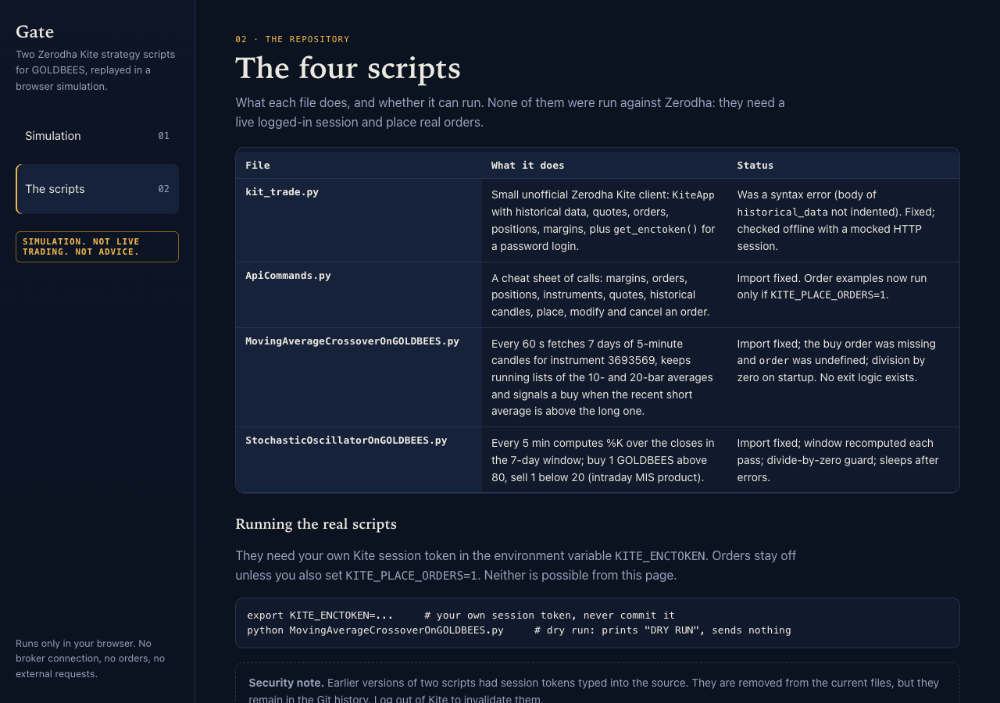
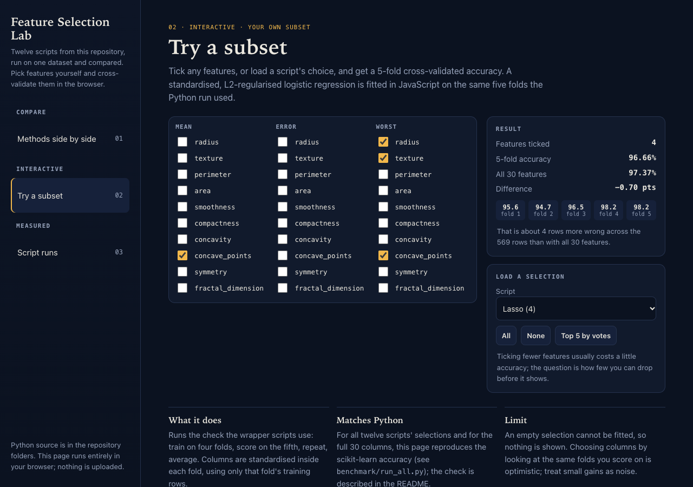

# Feature-Selection

Twelve scikit-learn scripts that pick a subset of columns from a table, grouped by the four usual families: **filter**, **wrapper**, **embedded** and **hybrid**. Each script reads a CSV whose last column is the class label and writes a smaller CSV with only the columns it kept.

This repository now also has a data file to run them on, one fixed set of measured results, and a browser demo that compares all twelve side by side.



## Demo

Open `docs/index.html` in a browser (double-click it; no server, no internet needed). It has three tabs:

1. **Methods side by side**: a 30 x 12 grid showing which feature each script kept, accuracy per method, and a "kept by at least N scripts" consensus slider.
2. **Try a subset**: tick any features and get a 5-fold cross-validated accuracy, computed in JavaScript (standardised, L2-regularised logistic regression on the same five folds as the Python run). Load any script's choice with one click.
3. **Script runs**: the table below, with the rule each script uses.



The page is a single self-contained file. GitHub Pages is not enabled; if you want it online, set Pages to serve `/docs` on `main`.

## Run the scripts

```bash
python3 -m venv .venv && source .venv/bin/activate
pip install -r requirements.txt
python Filter/ANOVA.py breast_cancer.csv            # file name is looked up in data/
python Wrapper/RFE.py /full/path/to/your.csv        # or give a path
python benchmark/run_all.py                          # all twelve + scoring; about 4 minutes
```

Rules every script follows: the **last column is the target**, the other columns are numeric features, and results are written to `outputs/` (created on demand, git-ignored). If you omit the argument the script asks for the file name. `benchmark/run_all.py` runs every script, reads back what each kept, scores it and writes `benchmark/results.json`, which is what the demo shows.

## Dataset

The original scripts read from a `PSO-main/data/` folder (file names in the code include `FINAL_qsar.csv`, `n_Toxicity.csv`, `n_Swarm.csv`). Those files are not in this repository, so there was nothing to run them on. To get real measured results, `data/breast_cancer.csv` was exported from scikit-learn's bundled breast-cancer dataset (the Wisconsin diagnostic table): **569 rows, 30 numeric features, binary target** (`target`: 357 ones, 212 zeros, no missing values). Results on your own CSV will differ.

## Measured results

Dataset `data/breast_cancer.csv`. "5-fold acc." is a standardised logistic regression trained on only the kept columns, `StratifiedKFold(5, shuffle=True, random_state=42)`. Using **all 30 features** with the same model and folds scores **97.37%**. Seeds: `random_state=42` or `random.seed(42)` / `np.random.seed(42)` inside each script that uses randomness; re-running the two slowest random scripts (Ant, genetic) gave the same selections. Runtimes are from one laptop and are only indicative.

| Script | Family | What it does | Kept | 5-fold acc. | Time |
|---|---|---|---|---|---|
| `Filter/ANOVA.py` | Filter | Scores each column by an ANOVA F-test against the class label and keeps the 10 best (`SelectKBest(f_classif, k=10)`; 10 is hard-coded). | 10 of 30 | 95.08% | 1.6 s |
| `Filter/InformationGain.py` | Filter | Estimates mutual information between each column and the label (`mutual_info_classif`) and keeps columns above the mean score. | 15 of 30 | 94.73% | 1.2 s |
| `Filter/CST3.py` | Filter | Chi-squared score per column on data scaled to [0, 1] (chi-squared needs non-negative input); keeps columns above the mean score. | 14 of 30 | 94.91% | 2.4 s |
| `Wrapper/ForwardSelection.py` | Wrapper | Adds one feature at a time, each time the one that most improves 5-fold logistic-regression accuracy (`SequentialFeatureSelector`). The outer loop repeats this for every size 1-29 and keeps the size with the best cross-validated score. | 22 of 30 | 97.02% | 128.7 s |
| `Wrapper/BackwardsElimination.py` | Wrapper | Starts from all columns and removes the least useful one at a time until 5 remain (5 is hard-coded). | 5 of 30 | 97.36% | 8.1 s |
| `Wrapper/RFE.py` | Wrapper | Recursive feature elimination around logistic regression: fit, drop the weakest coefficient, repeat. The script tries every size and keeps the best by 5-fold CV. | 30 of 30 | 97.37% | 6.1 s |
| `Embedded/LassoRegression.py` | Embedded | Fits an L1-penalised linear model (alpha 0.01) on [0, 1]-scaled data; columns whose coefficient is shrunk to exactly zero are dropped. | 4 of 30 | 96.66% | 1.5 s |
| `Embedded/RR.py` | Embedded | Fits an L2-penalised linear model on standardised data and keeps columns whose absolute coefficient is above the mean absolute coefficient. Ridge never zeroes a coefficient, so the cut-off is the script's own rule. | 11 of 30 | 95.08% | 1.1 s |
| `Embedded/Tree.py` | Embedded | Fits `ExtraTreesClassifier` and keeps columns with importance above 0.01. | 21 of 30 | 97.37% | 1.7 s |
| `Hybrid/ChiSimulatedAnnealing.py` | Hybrid | Chi-squared keeps the above-average columns, then simulated annealing flips one column in or out per step, scoring each subset with logistic regression on a 70/30 split, cooling from 100 to 1 with factor 0.9. | 8 of 30 | 94.03% | 1.4 s |
| `Hybrid/GeneticAlgorithmClassifier_FS.py` | Hybrid | A population of 50 on/off masks evolves for 20 generations (two-point crossover, bit-flip mutation, tournament selection); fitness is random-forest accuracy on a 70/30 split. Needs `deap`. | 15 of 30 | 95.78% | 35.2 s |
| `Hybrid/Ant.py` | Hybrid | 10 "ants" x 100 iterations each draw a subset and score it by 5-fold CV. See the honest notes: the pheromone is never read, so this is a random search. | 16 of 30 | 97.19% | 32.7 s |

Reading the numbers: one row out of 569 is 0.18 percentage points, so differences below about 0.5 points are not meaningful. Backward elimination (5 features), RFE (all 30), Extra-trees (21) and the 30-feature baseline are the same to within 0.01 points. The filters, Ridge and chi-squared + annealing are 2.3 to 3.3 points lower; the genetic algorithm is 1.6 lower. This is one dataset and one classifier.

## The four families, briefly

- **Filter** (`Filter/`): score each column on its own against the label, keep the best. Fast and model-free, but blind to how columns work together; the three filters here all kept the near-duplicate radius / perimeter / area columns.
- **Wrapper** (`Wrapper/`): train a model on candidate subsets and keep what scores best. Accurate for that model but slow: forward selection took about 129 s of the roughly 4 minutes for all twelve.
- **Embedded** (`Embedded/`): the model's own training exposes importance (Lasso zeroes coefficients, trees report importances). One fit, so cheap; Lasso kept only 4 columns and lost 0.7 points.
- **Hybrid** (`Hybrid/`): a cheap filter or a search heuristic combined with a model score. Simulated annealing, a genetic algorithm and ant-colony search try many subsets and keep the best-scoring one.

## Honest notes

- **Dataset stand-in.** See Dataset above. The numbers describe these scripts on the breast-cancer table, not on the QSAR / toxicity / swarm files they were written for.
- **Selection used every row.** The scripts choose columns using the whole table, and the accuracy above is then measured on the same table. That favours the wrappers and hybrids, which optimise accuracy directly. A fair estimate would select inside each training fold.
- **Hold-out scoring in the hybrids.** `ChiSimulatedAnnealing.py` and `GeneticAlgorithmClassifier_FS.py` score subsets on one 70/30 split and keep whichever scores best on the 30%. The best accuracy they print (annealing and genetic) is therefore optimistic.
- **`Ant.py` is a random search.** `generate_path` switches each feature on with probability 0.5 and never consults the pheromone matrix that the code updates, so the "ant colony" does not learn. It is left as written and labelled in the output. The result (16 features, 97.19%) is a good random subset, not evidence the colony helped.
- **Lasso and Ridge treat the label as a number.** Fine for a 0/1 target (as here); for three or more classes the coefficients would depend on the arbitrary label order.
- **Hard-coded settings are kept**: ANOVA k = 10, backward elimination target of 5 features, Extra-trees threshold 0.01, Lasso alpha 0.01. Change them in the script if you need other sizes.
- **Only the breast-cancer table was run**, with one seed. Timing and the selected sets of the random scripts can change with another seed or another scikit-learn version (run with scikit-learn 1.9.1, pandas 3.1.1, numpy 2.4.6, deap 1.4).

## Fixes made

All fixes are in the first commit, so they can be reverted separately from the docs.

- Every script: the hard-coded `PSO-main/data` path (relative to wherever you launched Python) is replaced by the repository's `data/` folder; the CSV is taken from the command line or a prompt; outputs go to `outputs/`, created if missing. (`CST3.py` and `RR.py` wrote into sub-folders that nothing created; by reading the code they would fail unless those folders already existed.)
- `Embedded/Tree.py` and `Wrapper/RFE.py`: used `X.columns` after `MinMaxScaler.fit_transform`, which returns a bare array. By reading the code this raises `AttributeError`; the scaled data now keeps its column names. `Tree.py` also prints the selected features and uses `random_state=42`.
- `Filter/ANOVA.py`: the mean imputer ran before the text-column encoder, so a text column would fail; the order is swapped.
- `Filter/InformationGain.py`: `random_state=42` for the mutual-information estimator.
- `Hybrid/GeneticAlgorithmClassifier_FS.py`: used a hard-coded column called `Class` for the label; it now uses the CSV's last-column name, copies the frame before adding to it, is seeded, and prints the best fitness.
- `Hybrid/ChiSimulatedAnnealing.py`: an empty subset (the random start or a flip can produce one) cannot be fitted; it now scores 0. Seeded; `LogisticRegression(max_iter=1000)`; prints the best hold-out accuracy.
- `Hybrid/Ant.py`: seeded, copies a slice before assigning (removes a pandas warning), prints the chosen features and best CV score, and carries a comment about the unused pheromone.
- Added `requirements.txt`, `.gitignore`, `data/breast_cancer.csv`, `benchmark/run_all.py` + `results.json`, and `docs/`.
- Line endings: several files used CRLF and were rewritten with LF, so the diff for those files is the whole file.

## Layout

```
Feature-Selection/
├── Filter/        ANOVA.py  InformationGain.py  CST3.py
├── Wrapper/       ForwardSelection.py  BackwardsElimination.py  RFE.py
├── Embedded/      LassoRegression.py  RR.py  Tree.py
├── Hybrid/        ChiSimulatedAnnealing.py  GeneticAlgorithmClassifier_FS.py  Ant.py
├── data/          breast_cancer.csv         (569 x 31, from scikit-learn)
├── benchmark/     run_all.py  results.json
├── docs/          index.html  assets/       (the demo and its screenshots)
├── requirements.txt
└── .gitignore
```

12 scripts (3 filter, 3 wrapper, 3 embedded, 3 hybrid); there were no empty stubs or duplicate files.

## Requirements

Tested on Python 3.11; `scikit-learn`, `pandas`, `numpy`, and `deap` (only for the genetic-algorithm script). `pip install -r requirements.txt`.
